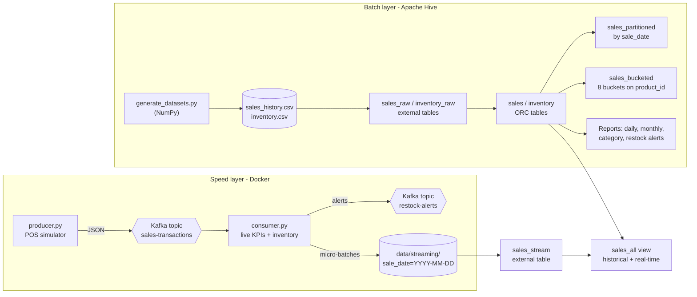

# Smart Retail Analytics System

A big-data analytics application for a multi-store retail chain. It combines
**batch analytics on historical sales** (Apache Hive / HiveQL) with **real-time
sales monitoring** (Apache Kafka), with the streaming stack deployed using
**Docker Compose**.

## Features

- **Historical analytics:** total revenue, category-wise revenue and margins,
  best-selling products, store rankings, daily and monthly sales reports
- **Inventory monitoring:** restocking alerts by urgency, supplier purchase
  orders, days-of-stock-left forecasting, overstock detection
- **Real-time processing:** a POS simulator streams transactions through Kafka;
  a stream processor keeps live KPIs, decrements stock, and publishes restock
  alerts as soon as an item drops below its reorder level
- **Unified view:** real-time micro-batches are queryable in Hive alongside
  historical data (`sales_all` view)
- **Query optimization:** ORC storage, date partitioning, product bucketing,
  table/column statistics, vectorized execution and cost-based optimization
- **Containerized:** Kafka, topic setup, producer, consumer and Kafka UI start
  with one command

## Architecture



## Tech stack

| Technology | Purpose |
|---|---|
| Apache Hive 4.1 + HiveQL | Data warehousing and historical sales analysis |
| Hadoop 3.4 (local mode) | Filesystem and MapReduce execution for Hive |
| Hive partitioning | Organizes sales by transaction date for partition pruning |
| Hive bucketing | Distributes sales into buckets by `product_id` |
| Apache Kafka 3.9 (KRaft) | Streams real-time sales transactions and restock alerts |
| Docker / Docker Compose | Containerizes and orchestrates the streaming components |
| Python 3, NumPy, confluent-kafka | Data generation, producer and stream processor |
| Java 17, Ubuntu 24.04 | Runtime environment |

## Project structure

```
smart-retail-analytics/
├── conf/
│   ├── hive-site.xml              # Local-mode Hive config (embedded Derby metastore)
│   └── beeline-log4j2.properties  # Quieter logging
├── data/
│   ├── historical/sales_history.csv   # 50,000 transactions, Jan-Jun 2026
│   ├── inventory/inventory.csv        # 300 rows: 5 stores x 60 products
│   └── streaming/                     # Real-time micro-batches (generated)
├── docker/streaming.Dockerfile    # Image for producer + consumer
├── kafka/
│   ├── producer/producer.py       # Real-time POS simulator
│   └── consumer/consumer.py       # Live monitor, restock alerts, Hive landing
├── reports/                       # Query results and exported CSV reports
├── scripts/
│   ├── generate_datasets.py       # Steps 2-3: synthetic datasets
│   ├── hive.sh                    # Runs HiveQL via embedded beeline
│   ├── create_topics.sh           # Creates Kafka topics (host mode)
│   └── run_all.sh                 # Runs the whole batch pipeline
├── sql/
│   ├── 01_create_database.sql
│   ├── 02_create_sales_table.sql
│   ├── 03_sales_analytics.sql
│   ├── 04_inventory_analysis.sql
│   ├── 05_partitioning_bucketing.sql
│   ├── 06_query_optimization.sql
│   └── 07_streaming_analytics.sql
├── docker-compose.yml
└── requirements.txt
```

## Procedure to files

| Step | Description | File |
|---|---|---|
| 1 | Project structure | repository layout |
| 2-3 | Historical sales and inventory datasets | `scripts/generate_datasets.py` |
| 4 | Hive database | `sql/01_create_database.sql` |
| 5 | Hive sales table | `sql/02_create_sales_table.sql` |
| 6.1-6.6 | Revenue, categories, best-sellers, stores, daily and monthly reports | `sql/03_sales_analytics.sql` |
| 7-9 | Inventory table, restocking, sales x inventory analysis | `sql/04_inventory_analysis.sql` |
| 10-11 | Partitioned and bucketed tables | `sql/05_partitioning_bucketing.sql` |
| - | Query optimization and benchmark | `sql/06_query_optimization.sql` |
| 12 | Kafka streaming workflow | `kafka/`, `sql/07_streaming_analytics.sql` |
| 13 | Containerization | `docker-compose.yml`, `docker/streaming.Dockerfile` |

## Hive data model

| Table | Type | Storage | Description |
|---|---|---|---|
| `sales_raw` | External | Text (CSV) | Raw historical sales |
| `sales` | Managed | ORC | Typed sales table used for analytics |
| `inventory_raw` / `inventory` | External / Managed | Text / ORC | Stock per store and product |
| `daily_sales_report` | Managed | ORC | Daily KPIs with 7-day moving average |
| `restock_alerts` | Managed | ORC | Items below reorder level with order quantities |
| `stock_coverage` | Managed | ORC | Sales velocity and days of stock left |
| `sales_partitioned` | Managed | ORC | Partitioned by `sale_date` (181 partitions) |
| `sales_bucketed` | Managed | ORC | 8 buckets on `product_id` |
| `sales_optimized` | Managed | ORC | Partitioned by month, 4 buckets on `product_id` |
| `sales_stream` | External | Text (CSV) | Real-time data landed from Kafka |
| `sales_all` | View | - | Historical and real-time combined |

## Getting started

### Prerequisites

- Ubuntu 24.04 (native or WSL2), Java 17, Python 3.10+
- Hadoop 3.4.1 and Hive 4.1.0 extracted locally, with `HADOOP_HOME` and `HIVE_HOME` set and their `bin/` directories on `PATH`
- Docker Engine with the Compose plugin

### 1. Clone and set up Python

```bash
git clone https://github.com/<your-username>/smart-retail-analytics.git
cd smart-retail-analytics
python3 -m venv .venv && source .venv/bin/activate
pip install -r requirements.txt
```

### 2. Batch analytics (Hive)

```bash
./scripts/run_all.sh            # datasets -> metastore -> all HiveQL -> reports/
./scripts/hive.sh               # interactive HiveQL shell (USE retail_db;)
```

### 3. Real-time streaming (Docker)

```bash
docker compose up -d --build    # Kafka, topic init, consumer, producer, Kafka UI
docker compose logs -f consumer # live sales dashboard and restock alerts
```

Kafka UI: <http://localhost:8080>

Adjust the stream rate with `TX_RATE=20 docker compose up -d producer`.

### 4. Query real-time data in Hive

```bash
./scripts/hive.sh -f sql/07_streaming_analytics.sql
```

### Running the streaming scripts without containers

```bash
docker compose up -d kafka && ./scripts/create_topics.sh
python kafka/consumer/consumer.py                # terminal 1
python kafka/producer/producer.py --count 3000   # terminal 2
```

## Query optimization techniques

| Technique | Where | Benefit |
|---|---|---|
| ORC columnar storage (Snappy) | All managed tables | Reads only needed columns; compression |
| Partitioning by `sale_date` | `sales_partitioned` | Date filters read only matching partitions (`EXPLAIN DEPENDENCY` proves pruning) |
| Bucketing on `product_id` | `sales_bucketed`, `sales_optimized` | Each product in one file; efficient sampling and joins |
| Table and column statistics | `ANALYZE TABLE ...` | Better plans from the cost-based optimizer; `COUNT(*)` answered from metadata |
| Vectorized execution, CBO, predicate pushdown | `sql/06_query_optimization.sql` | Batch row processing and filter pushdown |

To reproduce the benchmark (raw text vs ORC vs partitioned):

```bash
./scripts/hive.sh --silent=false -f sql/06_query_optimization.sql 2>&1 | grep -E "selected \("
```

## Troubleshooting

| Problem | Fix |
|---|---|
| `Wrong FS: file://${hivevar:PROJECT_DIR}...` | Run SQL through `./scripts/hive.sh`, which substitutes the project path |
| `return code 2 from MapRedTask` on Java 17 | `scripts/hive.sh` adds the required `--add-opens` JVM flags |
| Kafka exits: `advertised.listeners cannot use ... 0.0.0.0` | Use `PLAINTEXT://:29092` style listeners (empty host), as in `docker-compose.yml` |
| `docker: unrecognized service` on WSL | Enable systemd in `/etc/wsl.conf` (`[boot] systemd=true`), then `wsl --shutdown` |
| Streaming files owned by root | Run `export HOST_UID=$(id -u) HOST_GID=$(id -g)` before `docker compose up` |

## Future work

- Run Hive on Tez or Spark, against HDFS, for multi-node scale
- Replace the micro-batch landing with Spark Structured Streaming
- Add a BI dashboard (Superset or Grafana) on top of Hive
- Demand forecasting to set dynamic reorder levels
